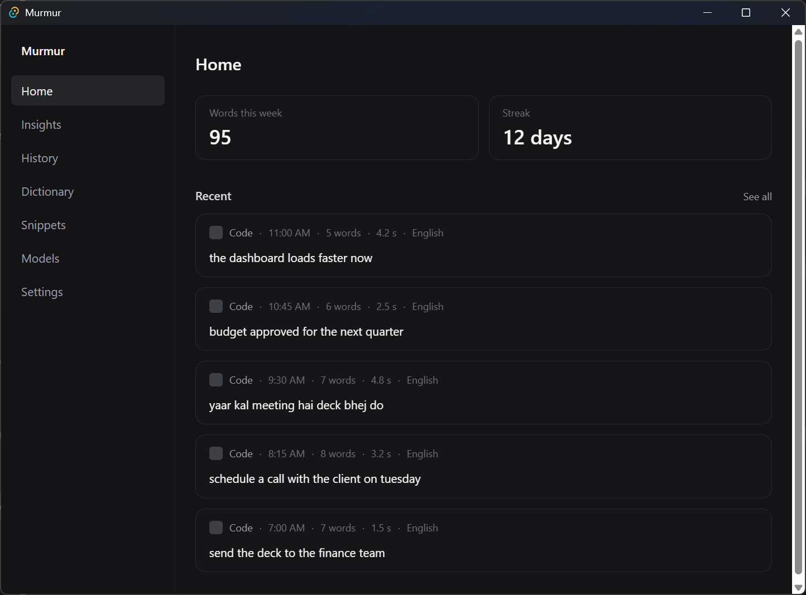
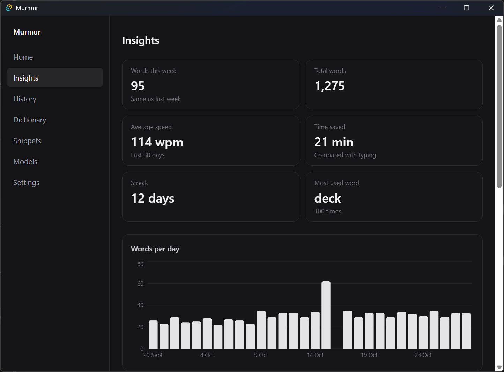
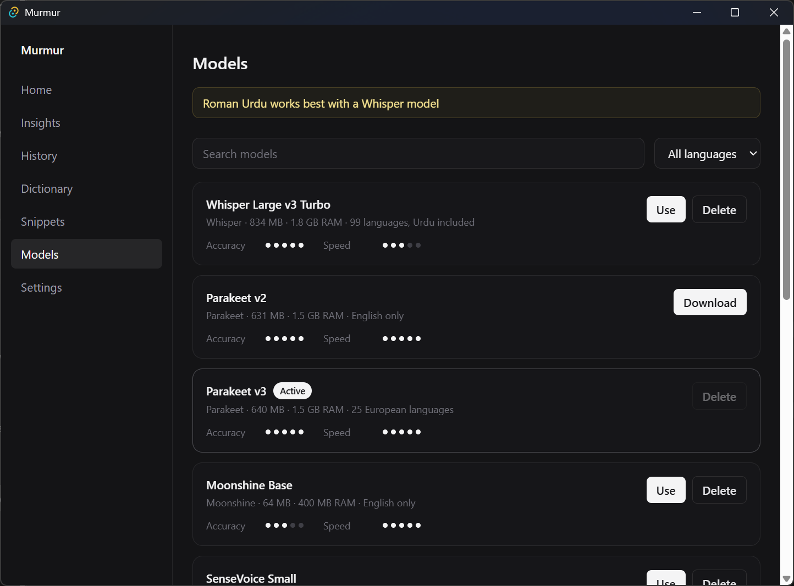
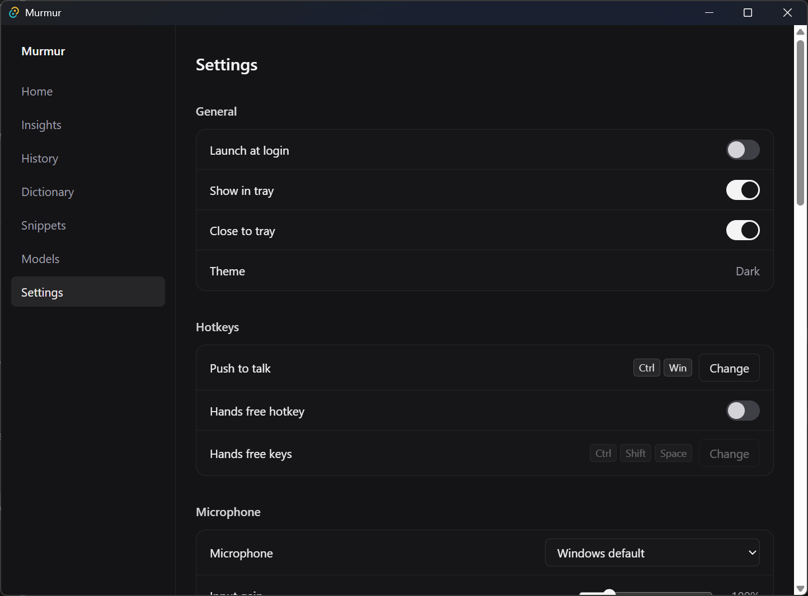
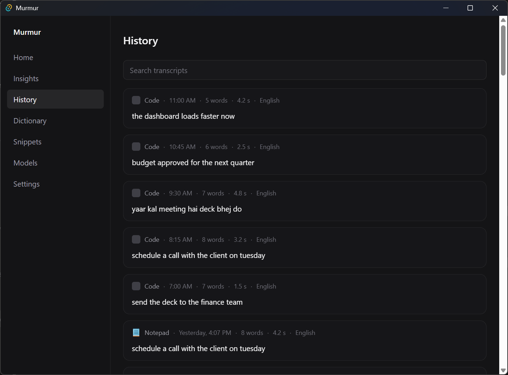

# Murmur

Free, open source, fully offline voice dictation for Windows on ARM64 (Snapdragon X).

Hold a hotkey, speak, release, and clean text is pasted into whatever app has focus. Speech models run on your own machine. Nothing you say leaves it.



## Features

- **Push to talk.** Hold Ctrl + Win, speak, let go. Double tap for hands free, press again to stop, Escape to cancel. Both hotkeys can be changed.
- **Pastes anywhere.** Clipboard paste with your old clipboard restored afterwards; terminals get Ctrl + Shift + V.
- **Clean text.** Filler words and stutters removed, sentences capitalised, your own dictionary and snippets applied, optional spoken punctuation.
- **English mixed with Roman Urdu.** Whisper keeps Urdu words in Latin script, and a spelling table makes them consistent.
- **Four model families.** Whisper, Parakeet, Moonshine and SenseVoice, downloaded from inside the app and switched without a restart.
- **History and insights.** Every transcript is searchable; the dashboard shows words per day, speaking speed, time saved, top words and apps.
- **A quiet pill.** A small waveform overlay that follows your voice and never takes focus.

| Insights | Models |
|---|---|
|  |  |

| Settings | History |
|---|---|
|  |  |

## Install

Windows 11 on ARM64 only. Every binary Murmur ships is native ARM64; nothing runs under x64 emulation.

Download from the latest release:

- `Murmur_<version>_arm64-setup.exe`: installs for the current user, no admin rights needed.
- `Murmur_<version>_arm64-portable.zip`: unzip anywhere and run `Murmur.exe`.

On first launch Murmur checks the microphone and offers its default model, Whisper Large v3 Turbo (834 MB). Allow desktop apps to use the microphone in Windows Settings > Privacy & security > Microphone if it asks.

The installer and uninstaller themselves are small 32 bit x86 programs, because NSIS has no ARM64 build, and so are the NSIS helpers they use while installing. Everything they install is ARM64.

## Models

Measured on a Snapdragon X Plus on mains power, on 5 short English clips and 5 English plus Roman Urdu clips.

| Model | Download | Languages | English WER | Time for a 5 s clip |
|---|---|---|---|---|
| Whisper Large v3 Turbo (default) | 834 MB | 99, Roman Urdu mixing | 6.1% | about 4.5 s |
| Parakeet v2 | 631 MB | English | 1.5% | about 0.1 s |
| Parakeet v3 | 640 MB | 25 European | not measured | about 0.1 s |
| SenseVoice Small | 228 MB | Chinese, English, Japanese, Korean, Cantonese | 6.1% | about 0.13 s |
| Moonshine Base | 64 MB | English | 10.6% | about 0.2 s |

Whisper Small, Medium, Large v3 and Large v3 Turbo (full and compact) are also in the catalogue. Any `ggml-*.bin` placed in `%APPDATA%\Murmur\models\custom\` appears as a Whisper model. For Roman Urdu, use a Whisper model: the others are trained without it.

## Privacy

- The only network request Murmur makes is downloading a model you clicked Download on. No telemetry, accounts, update checks or cloud transcription.
- Everything stays in `%APPDATA%\Murmur`: settings, history (SQLite), dictionary, snippets, models.
- Microphone audio is never written to disk unless you turn on Settings > Privacy > Keep audio clips.

## Build from source

Needs, all ARM64 builds: Rust (`aarch64-pc-windows-msvc`), Visual Studio 2022 Build Tools with the MSVC ARM64 tools, LLVM (on PATH), CMake, Ninja, Node and pnpm 9.

```
powershell -ExecutionPolicy Bypass -File scripts/fetch_onnxruntime.ps1
pnpm install
pnpm tauri dev
```

The first command fetches Microsoft's official ONNX Runtime for Windows ARM64 into `src-tauri/vendor/`, which the Parakeet, Moonshine and SenseVoice engines need.

Release build, installer and portable zip:

```
pnpm tauri build
powershell -ExecutionPolicy Bypass -File scripts/package_portable.ps1
powershell -ExecutionPolicy Bypass -File scripts/verify_arm64.ps1 -AllowX86Installer src-tauri/target/aarch64-pc-windows-msvc/release/bundle/nsis dist-release
```

Pushing a `v*` tag runs `.github/workflows/release.yml` on a Windows ARM64 runner, which builds both and attaches them to a GitHub release.

Tests: `pnpm test` and `cargo test` in `src-tauri`. `cargo test fixture_wer -- --ignored --nocapture` measures word error rate on recorded clips in `tests/audio/`.

## Licence

MIT. See LICENSE, and NOTICE for the projects Murmur builds on and the licences of the speech models.
